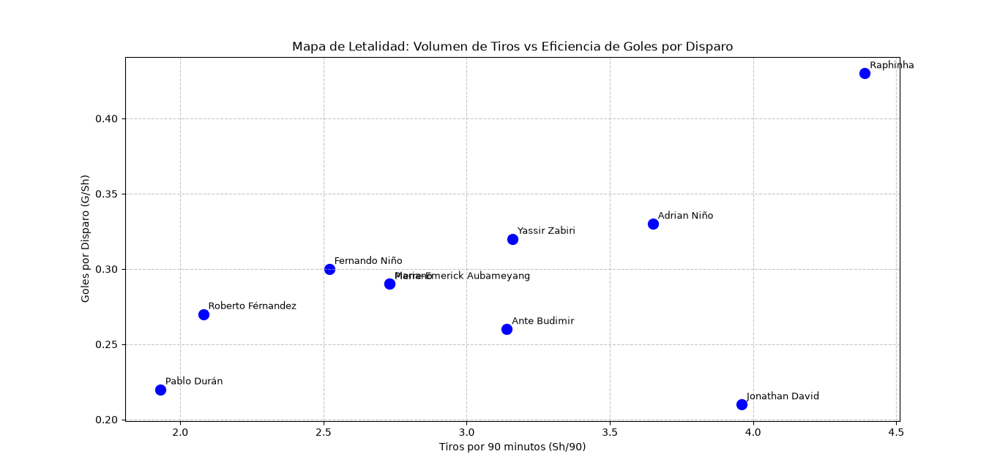

# ⚽ Análisis de Scouting: Delanteros más Letales (La Liga 2026-2027)

## 📌 Descripción del Proyecto
Este proyecto utiliza Python y la librería Pandas para analizar datos de rendimiento de jugadores de fútbol. El objetivo es identificar a los delanteros más eficientes de La Liga, evaluando no solo su cantidad de goles, sino su relación de goles por disparo (G/Sh) y su volumen de tiro por partido (Sh/90).

"Nota metodológica: Los datos analizados corresponden a la fecha de descarga del dataset (Noviembre de 2026). Al ser una temporada en curso, las métricas son parciales y pueden variar a medida que avancen las jornadas."

## 🎯 Preguntas de Negocio (Insights)
Como analista de datos deportivos, busqué responder:
1. ¿Quiénes son los delanteros más letales (eficientes) de la liga?
2. ¿Existen "gangas" de mercado (jugadores de equipos pequeños con alta eficiencia)?
3. ¿Qué delanteros disparan mucho pero con baja precisión?

## 🛠️ Tecnologías Utilizadas
*   **Python 3.x**
*   **Pandas:** Para la manipulación, limpieza y filtrado de datos (CSV).
*   **Matplotlib:** Para la creación del gráfico de dispersión (Scatter Plot).
*   **VS Code** como entorno de desarrollo.

## 📊 Visualización Destacada

*El gráfico muestra en el eje X los tiros por 90 minutos y en el eje Y la eficiencia (goles por tiro). Raphinha destaca en la esquina superior derecha como el jugador más letal y con mayor volumen de tiro.*

## 🚀 Cómo ejecutar este proyecto
1. Clona este repositorio.
2. Instala las dependencias: `pip install pandas matplotlib`
3. Ejecuta el script: `python src/analisis_delanteros.py`

## 🧠 Conclusiones Principales
*   **Raphinha** es el delantero más dominante de la muestra analizada, combinando un alto volumen de disparo con una eficiencia sobresaliente.
*   Jugadores como **Adrian Niño (Málaga)** y **Yassir Zabiri (Racing)** presentan métricas de eficiencia superiores al promedio, lo que los convierte en objetivos de scouting interesantes para equipos de mayor presupuesto.

---
*Análisis realizado por Daniela Jimenez como parte de mi portafolio de análisis de datos deportivos.*
*6 de noviembre de 2026*
